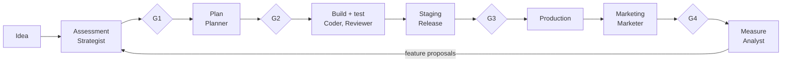

# Project OS architecture

Version 0, 2026-10-29. Based on the agreed draft and on the workflow running in
good-ideas.

## Lifecycle

Every step reads the project memory before it starts and writes back when it ends.

## Orchestration

The orchestrator is not a free-running LLM. It is a state machine that reads the
tracker: a ticket goes to an agent only when it is in an active state and carries
the ready label. In good-ideas this role is played by
[Symphony](https://github.com/openai/symphony) v0.0.3, which polls the tracker
every 30 seconds and runs Codex in a separate clone of the repository per ticket.

Since core 0.2.0 the Symphony control code is part of the core (see
[Symphony in the core](symphony.md)); projects receive a pinned copy. The core
keeps Symphony as its orchestrator. The tracker and runtime are declared in
`project.yaml`. Since core 0.3.0 the default tracker is GitHub Issues of the
project's own repository (Symphony v0.0.3 ships a GitHub reader); Jira is still
supported for projects that have not moved. Gates and labels are unchanged.

## Agents

Each agent has one job, one output and a list of things it must not do. See
[`agents/`](../agents/README.md). In v0 only the Coder runs autonomously (through
Symphony). The other roles are written contracts, switched on step by step along
the roadmap.

## Autonomy levels

Each module in `project.yaml` has a level:

| Level | Name           | Meaning                                                   |
| ----- | -------------- | --------------------------------------------------------- |
| L0    | Suggest        | The agent proposes, a person does the work.               |
| L1    | Ask first      | The agent acts after a person approves. Default at start. |
| L2    | Act and report | The agent acts; a person reads a summary and can undo.    |
| L3    | Autonomous     | Reports only on failure. Fits tests, cleanup, upgrades.   |

Gates G1, G2 and G4 never go below L1.

## Memory

| File                  | Edited by          | Content                                                                             |
| --------------------- | ------------------ | ----------------------------------------------------------------------------------- |
| `memory/vision.md`    | Project owner only | Who it is for, what it solves, what it will not do.                                 |
| `memory/decisions/`   | Agents and people  | ADRs: why X was chosen over Y.                                                      |
| `memory/state.md`     | Agents             | What is in progress, who is on it, what is blocked.                                 |
| `memory/learnings.md` | Agents             | Mistakes met and how they were fixed. General lessons are proposed to `playbooks/`. |

The detailed state of each ticket stays in an `## Agent Workpad` comment on the
tracker, as in good-ideas. `memory/state.md` is the project-level summary.

## Upgrading the core

1. The core bumps `VERSION` and records the change in `CHANGELOG.md`.
2. The project changes `core.version` in `project.yaml`, compares the new
   template with its own files and applies what it needs.
3. `node scripts/check-project.mjs <project>` must pass.

There is no automatic template sync yet. That waits for a second project.
