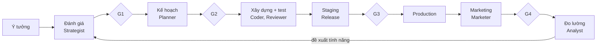

# Kiến trúc Project OS

Bản v0, 2026-10-29. Dựa trên bản phác thảo đã thảo luận và quy trình đang chạy
trong good-ideas.

## Vòng đời

Mọi bước đọc bộ nhớ dự án trước khi làm và ghi lại sau khi làm.

## Điều phối

Điều phối viên không phải một LLM tự do. Nó là một máy trạng thái đọc tracker:
một ticket chỉ được giao cho agent khi ở trạng thái đang hoạt động và có nhãn
sẵn sàng. Ở good-ideas, vai trò này do [Symphony](https://github.com/openai/symphony)
v0.0.3 đảm nhận, đọc Jira mỗi 30 giây và chạy Codex trong một bản sao repo riêng
cho từng ticket.

Từ lõi 0.2.0, mã điều khiển Symphony là một phần của lõi (xem
[Symphony trong lõi](symphony.md)); dự án nhận một bản sao được ghim phiên bản.
Lõi giữ nguyên lựa chọn Symphony. Tracker và runtime được khai báo trong
`project.yaml`. Từ lõi 0.3.0, tracker mặc định là GitHub Issues của chính repo dự
án (Symphony v0.0.3 có sẵn bộ đọc GitHub); Jira vẫn được hỗ trợ cho dự án chưa
chuyển. Khái niệm cổng và nhãn không đổi.

## Agent

Mỗi agent có một việc, một đầu ra và một danh sách việc không được làm. Xem
[`agents/`](../agents/README.md). Ở v0 chỉ có Coder chạy tự động thật (qua
Symphony). Các vai trò còn lại là hợp đồng đã viết sẵn để bật dần theo lộ trình.

## Mức tự chủ

Mỗi module trong `project.yaml` có một mức:

| Mức | Tên         | Nghĩa                                                 |
| --- | ----------- | ----------------------------------------------------- |
| L0  | Gợi ý       | Agent đề xuất, người làm.                             |
| L1  | Hỏi trước   | Agent làm sau khi người duyệt. Mặc định lúc đầu.      |
| L2  | Làm rồi báo | Agent làm, người xem tóm tắt và có thể hoàn tác.      |
| L3  | Tự động     | Chỉ báo khi lỗi. Hợp với test, dọn dẹp, cập nhật gói. |

Cổng G1, G2 và G4 không bao giờ hạ xuống dưới L1.

## Bộ nhớ

| File                  | Ai sửa        | Nội dung                                                                    |
| --------------------- | ------------- | --------------------------------------------------------------------------- |
| `memory/vision.md`    | Chỉ chủ dự án | Cho ai, giải quyết gì, không làm gì.                                        |
| `memory/decisions/`   | Agent + người | ADR: vì sao chọn X thay vì Y.                                               |
| `memory/state.md`     | Agent         | Đang làm gì, ai làm, bị chặn ở đâu.                                         |
| `memory/learnings.md` | Agent         | Lỗi đã gặp và cách sửa. Bài học chung được đề xuất về `playbooks/` của lõi. |

Trạng thái chi tiết của từng ticket vẫn nằm trong một comment `## Agent Workpad`
trên tracker, như good-ideas đang làm. `memory/state.md` là bản tóm tắt cấp dự án.

## Nâng cấp lõi

1. Lõi tăng `VERSION` và ghi `CHANGELOG.md`.
2. Dự án đổi `core.version` trong `project.yaml`, so sánh template mới với file
   của mình, áp phần cần thiết.
3. `node scripts/check-project.mjs <dự án>` phải chạy qua.

Chưa có công cụ tự đồng bộ template. Việc này để sau khi có dự án thứ hai.
