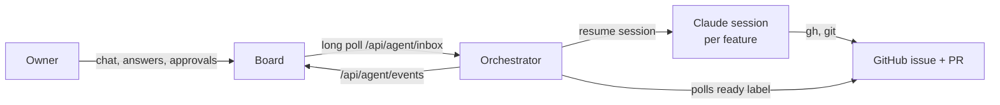

# Claude orchestrator

The Claude orchestrator runs one long-lived Claude session per feature and links it to
the board, so the owner can talk to the agent at any stage and keep editing a pull
request by chat. It replaces Symphony for a project that sets
`runtime.orchestrator: claude`. Why it exists and what it changes is in
[ADR-0001](decisions/ADR-0001-claude-session-orchestrator.md).

## How it works



- `ready` on an open issue starts the feature's session with the `WORKFLOW.md` prompt.
  When the agent hands off and the owner asks for rework (the board adds `ready`
  again), the same session resumes with "attempt N".
- A chat message resumes the session at any stage. Before `ready` the agent may read,
  discuss and refine the plan, but may not branch, commit or open a pull request.
- Messages sent during a turn are queued and arrive together as the next turn.
- The agent asks with `AskUserQuestion`; the question appears in the panel with its
  options. Merging, force-pushing, pushing to the default branch, deploying and writing
  outside the workspace wait for "Allow" or "Deny". After
  `runtime.claude.approval_timeout_minutes` (30) without an answer, the step is refused
  and the feature waits for the owner.
- "Take over in a terminal" stops the running turn and shows the command that
  continues the session by hand. The orchestrator leaves the feature alone, keeping new
  messages, until "Hand back".

The orchestrator only calls out to the board. The board never calls the orchestrator,
so a Mac behind a home router needs no open port or tunnel.

## Settings

In `project.yaml`:

```yaml
runtime:
  orchestrator: claude
  agent: claude
  host: mac # default; ORCHESTRATOR_HOST overrides it
  max_concurrent_agents: 1
  claude: # all optional
    model: null # Claude Code's default when null
    max_turns: 200 # agent steps per message
    approval_timeout_minutes: 30
    poll_seconds: 30
```

`WORKFLOW.md` keeps its role: its prompt is the first turn of an approved feature, and
its `hooks.after_create` makes each feature's copy of the repository. Where the prompt
names the `github_api` tool, the agent is told to use `gh` instead.

Install the SDK in the project: `npm install @anthropic-ai/claude-agent-sdk`, and add
`"orchestrator:start": "node --env-file-if-exists=.env .project-os/orchestrator/start.mjs"`
to `package.json` if the project predates core 0.6.0.

Environment:

| Variable                  | Where      | Value                                                                  |
| ------------------------- | ---------- | ---------------------------------------------------------------------- |
| `AGENT_TOKEN`             | Both sides | The same random string, at least 32 characters                         |
| `AGENT_NAME`              | Orchestr.  | This agent's name when several share a board; see below                |
| `BOARD_URL`               | Orchestr.  | The board's address; https unless local or an internal hostname        |
| `GITHUB_TOKEN`            | Orchestr.  | A token for the agent's `gh`: issues, PRs and contents read/write      |
| `ORCHESTRATOR_STATE`      | Orchestr.  | State folder; defaults to `.orchestrator/` in the project              |
| `ORCHESTRATOR_HOST`       | Orchestr.  | `mac` or `dokploy`; overrides `runtime.host`. The image sets `dokploy` |
| `CLAUDE_CODE_OAUTH_TOKEN` | Dokploy    | From `claude setup-token`; or set `ANTHROPIC_API_KEY`                  |

The agent's environment gets everything except `AGENT_TOKEN`, `BOARD_URL` and the
board's own secrets.

## On the Mac

1. Sign in once with `claude` in a terminal. The orchestrator uses that login.
2. Add `AGENT_TOKEN` to the board (Dokploy env, or the local command) and redeploy it.
3. In the project, put `AGENT_TOKEN`, `BOARD_URL` and `GITHUB_TOKEN` in `.env`, then run
   `npm run orchestrator:start` and leave it running.
4. Features live in `.orchestrator/workspaces/<issue>`. To continue one by hand, press
   "Take over in a terminal" and run the command it shows:
   `cd '<workspace>' && claude --resume <session id>`.

## On Dokploy

1. Create an Application from the project repository, build type Dockerfile, path
   `.project-os/orchestrator/Dockerfile`, build context the repository root.
2. Mount a volume at `/data`. It holds the state, the workspaces and the sessions
   (`/data/home/.claude`); without it every redeploy forgets every session.
3. Set `AGENT_TOKEN`, `BOARD_URL` (for a board in the same Dokploy project, its internal
   address such as `http://<board service>:8080`), `GITHUB_TOKEN` and
   `CLAUDE_CODE_OAUTH_TOKEN`. If `after_create` clones over SSH, add a deploy key under
   `/data/home/.ssh` or switch the hook to HTTPS with the token.
4. No domain or port is needed. To take over, open the container's terminal in Dokploy
   and run the command the board shows inside it.

The host comes from `ORCHESTRATOR_HOST` when it is set, else from `runtime.host`, else
`mac`. The Dokploy image sets `ORCHESTRATOR_HOST=dokploy`, so the same commit runs on
either host without editing `project.yaml`; keep `runtime.host: mac` there as the
default for running by hand. Moving between the two means stopping the orchestrator in
one place, starting it in the other, and copying the state folder and
`~/.claude/projects/` across if the running sessions should come along. Run only one
orchestrator per project, unless they have different names (below).

## Several agents on one board

Each orchestrator that shares a board sets `AGENT_NAME` (for example `luan-mac`,
`friend-mac`, `dokploy`) and its own `AGENT_TOKEN`; the board lists the pairs in
`AGENT_TOKENS` (see "Several agents" in [the board docs](board.md)).

- A named agent takes only the features labelled `agent:<its name>`. One without a name
  takes only features without an `agent:` label.
- If the board knows the token under another name, the orchestrator stops at start-up
  instead of acting for that agent.
- When the owner moves a feature to another agent, this one stops its turn, refuses what
  it was waiting on, keeps the session id in `previousSessions` in its state file and
  never touches the feature again unless it comes back, which starts a new session.
- Each agent needs its own GitHub token and Claude login, and its own copy of the
  repository's access (the SSH key or deploy key for the clone hook).

## Limits of this version

- The board's relay is in memory. Restarting the board drops unsent messages and the
  live log; the sessions and their state are not affected.
- A turn that is running when the orchestrator stops is lost; the next message
  resumes the session from its last saved step.
- Review comments and failed checks do not reach the session yet; say so in the chat
  or use "Request changes".
- There is one agent role. Planner and reviewer sessions, a launchd service for the
  Mac and saving transcripts to the `board-sessions` branch are later changes.
